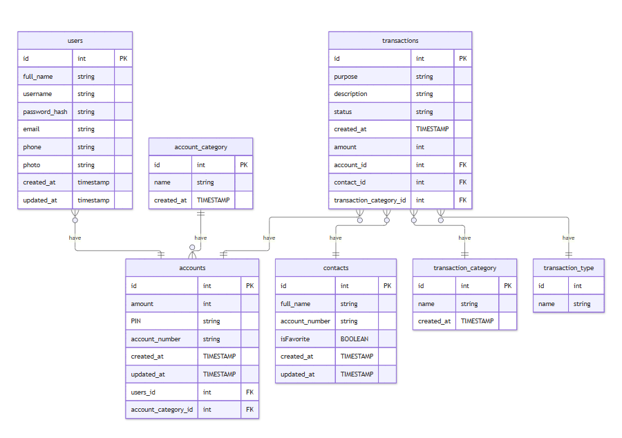
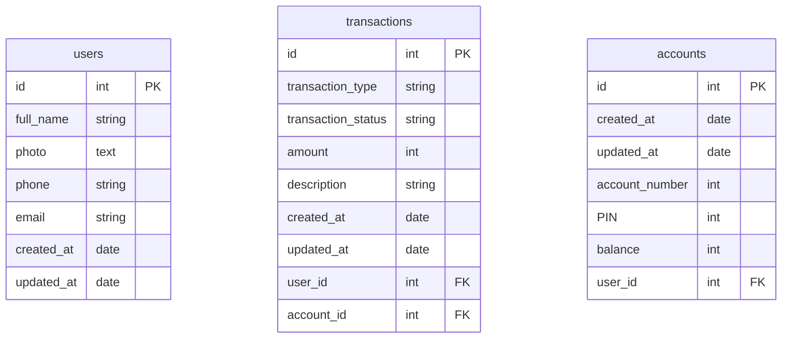

# ERD E-Wallet Seabank

<!-- erDiagram

users {
    id int PK
    full_name string
    username string
    password_hash string
    email string
    phone string
    photo string
    created_at timestamp
    updated_at timestamp
} -->

<!-- account_category{
    id int PK
    name string
    created_at TIMESTAMP
}

transaction_category{
    id int PK
    name string
    created_at TIMESTAMP
}

accounts {
    id int PK
    amount int
    PIN string
    account_number string
    created_at TIMESTAMP
    updated_at TIMESTAMP
    users_id int FK
    account_category_id int FK
}

users o{--|| accounts: "have"
account_category ||--}o accounts: "have"

contacts{
    id int PK
    full_name string
    account_number string
    isFavorite BOOLEAN
    created_at TIMESTAMP
    updated_at TIMESTAMP
}

transactions {
    id int PK
    purpose string
    description string
    status string
    created_at TIMESTAMP
    amount int

    account_id int FK
    contact_id int FK
    transaction_category_id int FK
    transaction_type_id int FK
} -->

<!-- transaction_type{
    id int
    name string
}

transactions o{--|| accounts: "have"
transactions o{--|| contacts: "have"
transactions o{--|| transaction_category: "have"
transactions o{--|| transaction_type: "have" -->

<!--  -->

